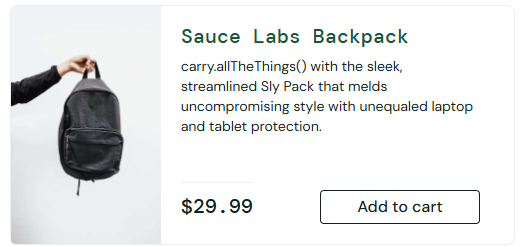
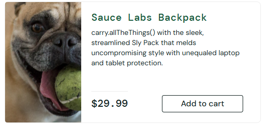

# SCRUM-15 — Incorrect Product Image for Sauce Labs Backpack

## Bug Details

| Field | Value |
|---|---|
| Application | [SauceDemo](https://www.saucedemo.com/) |
| Feature | Products / Product Listing |
| Test Account | `problem_user` |
| Status | To Do |
| Severity | Medium |
| Priority | Medium |
| Test Environment | Google Chrome, Windows 11 |

> **Demo application defect:** This behavior was reproduced with SauceDemo's fault-injected `problem_user` account. It is not a production defect.

## Steps to Reproduce

1. Open [SauceDemo](https://www.saucedemo.com/).
2. Log in with the `problem_user` test account.
3. On the Products page, locate **Sauce Labs Backpack**.
4. Compare the product image with the expected backpack image shown using the standard test account.

## Expected Result

The **Sauce Labs Backpack** product card displays an image of the backpack matching the product name.

## Actual Result

The **Sauce Labs Backpack** product card displays an unrelated image of a dog. The product title and price remain associated with Sauce Labs Backpack.

## Key Evidence

**Expected — correct backpack image**

**Actual — incorrect dog image**

## Additional Evidence

- [Original Jira bug report screenshot](SCRUM-15_JIRA_REPORT.png)
