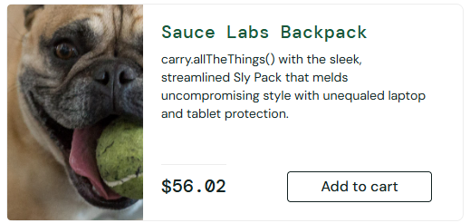
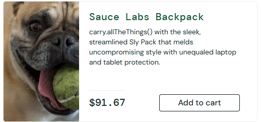

# SCRUM-17 — Backpack Price Changes After Refreshing Products Page

## Bug Details

| Field | Value |
|---|---|
| Application | [SauceDemo](https://www.saucedemo.com/) |
| Feature | Product Listing |
| Test Account | `visual_user` |
| Status | To Do |
| Severity | Medium |
| Priority | High |
| Test Environment | Google Chrome, Windows 11 |

> **Demo application defect:** This behavior was reproduced with SauceDemo's fault-injected `visual_user` account. It is not a production defect.

## Steps to Reproduce

1. Open [SauceDemo](https://www.saucedemo.com/) and log in with the `visual_user` test account.
2. Locate **Sauce Labs Backpack** on the Products page and note its displayed price.
3. Refresh the Products page repeatedly and compare the displayed price after each refresh.
4. Open the Backpack Product Details page and check the price.
5. Add Backpack to the Shopping Cart and check the price again.
6. Proceed to Checkout Overview and compare the product price before finishing the order.

## Expected Result

The **Sauce Labs Backpack** price remains **$29.99** across the Products page, Product Details, Cart and Checkout Overview, including after refreshing the Products page.

## Actual Result

The Backpack price on the Products page changed across refreshes (observed **$56.02**, **$91.67**, and **$31.98**). Product Details, Cart and Checkout Overview continued to display **$29.99**.

The inconsistent listing price may mislead users, even though the Checkout Overview price remained unchanged in the observed test.

## Key Evidence

**Products page — price on first observed screenshot**

**Products page — changed price after refresh**

## Additional Evidence

- [Products page — another observed price](SCRUM-17_PRODUCTS_03.png)
- [Product Details — comparison price](SCRUM-17_DETAILS.png)
- [Shopping Cart — comparison price](SCRUM-17_CART.png)
- [Checkout Overview — comparison price](SCRUM-17_OVERVIEW.png)
- [Original Jira bug report screenshot](SCRUM-17_JIRA_REPORT.png)
